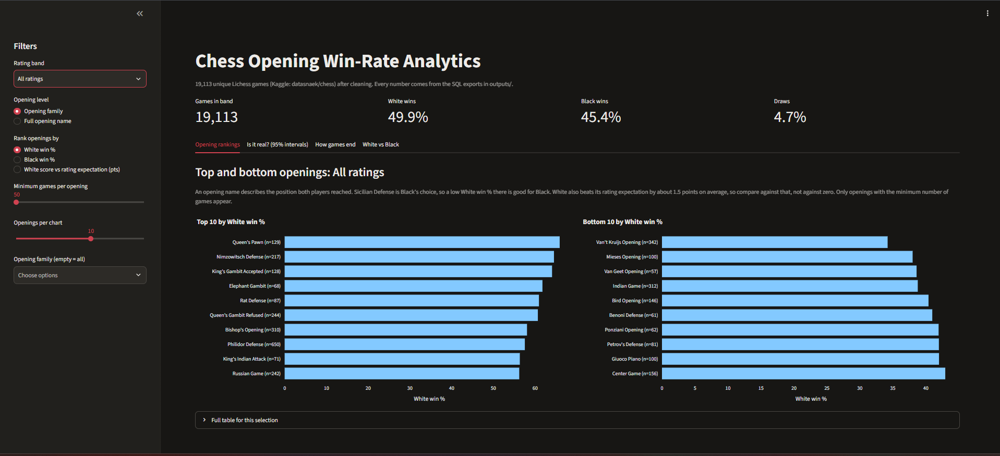
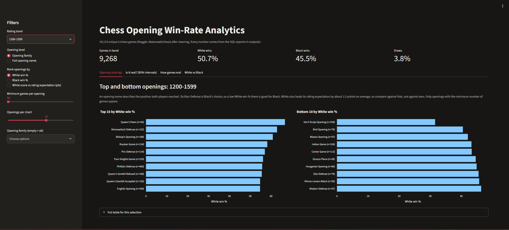
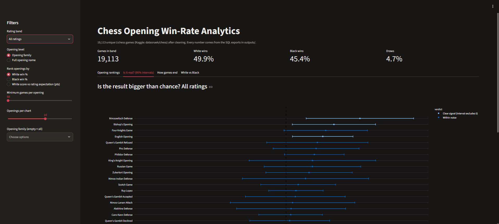
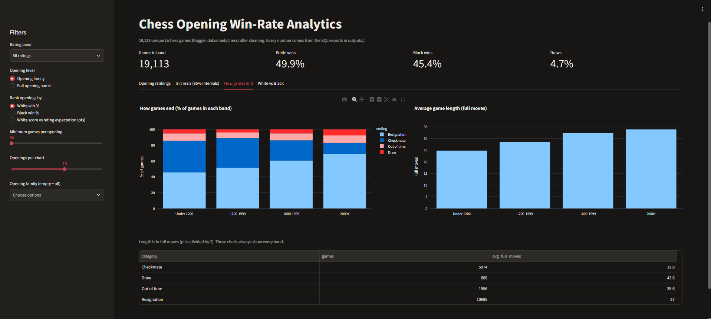
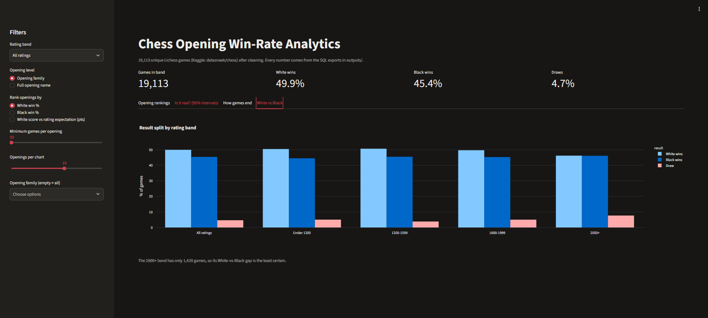

# Chess Opening Win-Rate Analytics

SQL + Python + Streamlit analysis of 19,113 unique Lichess games: how opening choice relates to results across rating bands, with ratings taken into account.

## Goal

Find out which openings really over- or under-perform, and separate that from the simple fact that stronger players pick certain openings. I'm a chess player and have worked as a chess arbiter at college events, so I chose a topic I know from the board.

## Dataset

[Chess Game Dataset (Lichess)](https://www.kaggle.com/datasets/datasnaek/chess) on Kaggle (`games.csv`). It has 20,058 rows with opening names, player ratings, winner, how the game ended and number of turns.

## Dashboard





Filters: rating band, opening family or full opening name, ranking metric, minimum games per opening, and an opening-family selector. The charts read only the SQL exports in `outputs/`.

## Key findings

| # | Finding | Evidence |
|---|---------|----------|
| 1 | Stronger players resign instead of getting checkmated | Checkmate falls from 40.09% of games (Under 1200) to 14.08% (2000+). Resignation rises from 45.59% to 68.94%. |
| 2 | White's advantage shrinks at the top | The White-minus-Black win-rate gap is 5.95, 5.16, 4.38 and 0.07 points from the lowest band to 2000+. Treat the 2000+ result with care: that band has only 1,420 games. |
| 3 | 1.e3 (Van't Kruijs Opening) underperforms even after adjusting for ratings | White scored 6.84 points below its normal edge over 342 games (95% interval -11.16 to -2.52). |




Other results:
- Overall, White wins 49.94%, Black wins 45.41% and 4.65% are draws.
- Games average 30.3 full moves. Draws are the longest (43.6 full moves) and resignations the shortest (27.0).
- English Opening (+4.27 points, 699 games) and Nimzowitsch Defense (+8.58, 217 games) beat their rating expectation across all ratings. English Opening is borderline, since its interval starts at +0.75.
- Several other openings (Bishop's Opening, Four Knights Game, Owen Defense, Center Game, Slav Defense, Indian Game) have intervals that only just exclude zero. I treat them as leads, not findings.

## Method

1. **Cleaning (pandas).** No missing values were found. 945 repeated game IDs were removed (429 exact copies, plus 516 that differed only in timestamp columns), leaving 19,113 unique games. Text labels were standardised.
2. **Rating bands.** From the average of White's and Black's rating: Under 1200, 1200-1599, 1600-1999, 2000+. Bands contain 1,110 / 9,268 / 7,315 / 1,420 games.
3. **Opening family.** There are 1,477 distinct opening names, which is too fine for reliable counts, so I also grouped them into 143 families by taking the name before the colon (for example "Sicilian Defense").
4. **SQL (SQLite).** Eight queries in `sql/`: White vs Black win rate, how games end (overall and by band), game length, and opening win rates at family and full-name level, raw and rating-adjusted.
5. **Minimum sample size.** Opening results are only reported for openings with at least 50 games, because win rates from very few games are mostly luck.
6. **Rating adjustment.** An opening can look good just because stronger players play it. For each game I compared White's actual result (win = 1, draw = 0.5, loss = 0) with the result the Elo formula predicts from the rating gap.
7. **Statistical check.** For families with 150+ games I computed a 95% confidence interval for the gap versus the band's normal White edge. Only intervals that exclude zero count as clear signals.

## Limitations

- Many openings were tested at once, so a few "clear" results are expected by chance alone.
- Some players appear in many games, so the real uncertainty is somewhat wider than the intervals show.
- The Elo formula is an approximation, since Lichess uses the Glicko-2 rating system.
- `turns` counts plies (half-moves). I report full moves by dividing by 2.
- The 2000+ band has no full opening names with 50+ games, so only family-level results exist there.
- Results show association, not cause. Players who choose unusual openings may differ in other ways.

## How to run the dashboard

```bash
git clone https://github.com/VirajK04/chess-opening-analytics.git
cd chess-opening-analytics
pip install -r requirements.txt
streamlit run scripts/07_dashboard.py
```

## How to rebuild everything from the raw data

Download `games.csv` from Kaggle into `data/`, then run:

```bash
python scripts/02_clean.py       # clean data, add rating bands and opening family
python scripts/03_load_db.py     # load into SQLite and add the Elo expected score
python scripts/04_run_sql.py     # run sql/*.sql and export outputs/*.csv
python scripts/06_confidence.py  # 95% confidence intervals (outputs/09_family_confidence.csv)
```

`scripts/01_explore.py` and `scripts/05_preview.py` are the inspection scripts I used along the way.

## Repository structure

data/ raw and derived data (not in git)
sql/ SQL queries
scripts/ Python: cleaning, loading, SQL runner, statistics, dashboard
outputs/ CSV exports used by the dashboard
screenshots/ dashboard screenshots

## Tools

Python, pandas, SQLite, Plotly, Streamlit, GitHub Codespaces.